# Baltic Assist email assets

Public images used in Baltic Assist IT emails. Templates live in `EMAIL_DESIGN_MAIN\EMAIL_TEMPLATES`.

**Don't rename, move or delete files here.** Emails that were already sent link to them and would show broken images.
To change an image, add it under a new name (or bump `ASSET_VERSION` in the template build) and update the templates.

## Using an image in a template

Link directly to the raw file, with the version marker:

```
https://raw.githubusercontent.com/aidas-ba/ba-email-assets/main/tiles/<icon>-<tone>.png?v=4
```

In a template, use the `__TILES__/` placeholder and the build fills in the address:

```html

```

Tiles are 240×240 transparent PNGs. Show them at **48×48** in cards (as in the Monitor / Due card), or 36–72 elsewhere.

**Tones:**
- **lavender:** default, the main subject of a card
- **slate:** a second item next to lavender, or a more serious topic
- **lilac:** a third item, or a softer accent
- **pink:** attention only (due dates, warnings, things to fix), matching the red/pink "attention" rule in the templates

## Logos

| File | Used for |
|---|---|
| `logo/ba-logo-navy.png` | **Current email logo**: brand navy for both words, red tick (shown at 140px) |
| `logo/ba-logo-dark.png` | Dark-mode logo, all white (Apple Mail / iPhone dark mode) |
| `logo/ba-logo-blue.png` | Earlier email logo (lighter blue); kept for emails already sent |
| `logo/ba-logo-halo.png` | Earlier email logo with white halo; kept for emails already sent |

## Tiles in use by the live templates

| File | Used for |
|---|---|
| `tiles/art-pastel-monitor.png` | Monitor card icon (same design as `monitor-lavender`) |
| `tiles/art-pastel-calendar.png` | Due-date card icon (same design as `calendar-pink`) |

## Tile library

41 icons × 4 tones. File name: `tiles/<icon>-<tone>.png`.
Regenerate or add icons with `art\render-tiles.ps1` (icons are defined in `art\art.html`); add new ones under new names.

### Devices

| Icon | lavender | slate | pink | lilac |
|---|:---:|:---:|:---:|:---:|
| `monitor` |  |  |  |  |
| `laptop` |  |  |  |  |
| `phone` | 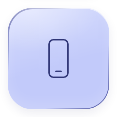 |  | 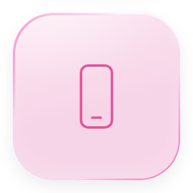 | 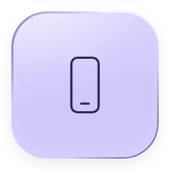 |
| `printer` | 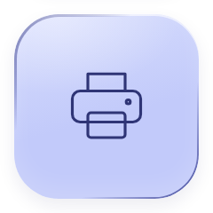 | 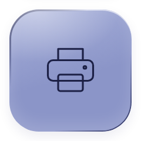 | 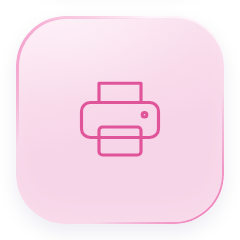 | 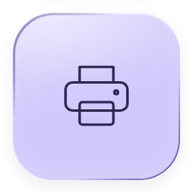 |
| `server` | 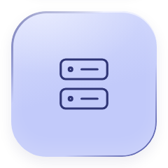 |  | 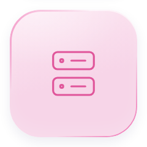 |  |
| `headset` |  |  |  |  |
| `wifi` |  |  | 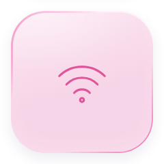 |  |
| `camera` |  |  |  |  |

### Access & security

| Icon | lavender | slate | pink | lilac |
|---|:---:|:---:|:---:|:---:|
| `key` | 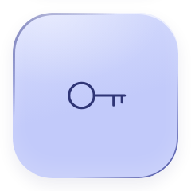 | 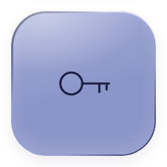 | 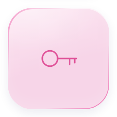 | 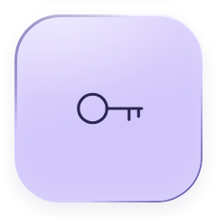 |
| `lock` |  |  |  |  |
| `shield` |  |  |  |  |
| `user` |  |  |  |  |
| `people` |  |  |  |  |

### Communication

| Icon | lavender | slate | pink | lilac |
|---|:---:|:---:|:---:|:---:|
| `mail` |  |  |  |  |
| `send` |  |  |  |  |
| `bell` |  |  |  |  |
| `link` |  |  |  |  |

### Files & forms

| Icon | lavender | slate | pink | lilac |
|---|:---:|:---:|:---:|:---:|
| `document` |  |  |  |  |
| `clipboard` |  |  |  |  |
| `download` |  |  |  | 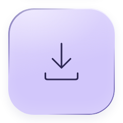 |
| `upload` |  |  | 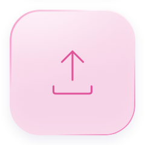 | 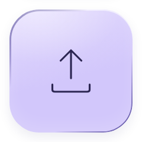 |
| `trash` | 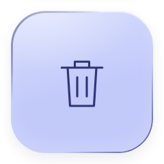 | 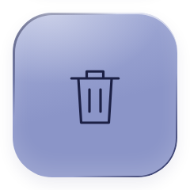 | 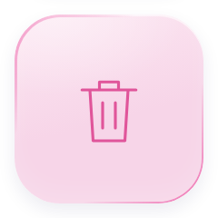 | 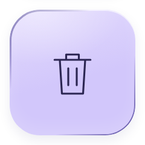 |

### Status

| Icon | lavender | slate | pink | lilac |
|---|:---:|:---:|:---:|:---:|
| `tick` |  |  |  |  |
| `alert` |  |  |  |  |
| `info` |  |  |  |  |
| `question` |  |  |  |  |
| `cross` |  |  | 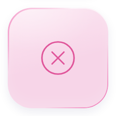 |  |
| `plus` |  |  | 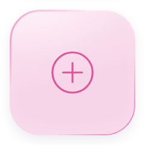 |  |
| `clock` |  |  |  |  |
| `calendar` |  |  | 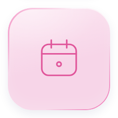 | 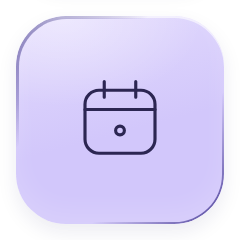 |
| `hourglass` |  |  |  |  |
| `refresh` |  |  |  |  |

### Places & things

| Icon | lavender | slate | pink | lilac |
|---|:---:|:---:|:---:|:---:|
| `pin` |  |  | 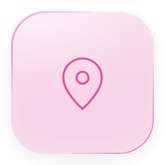 |  |
| `globe` |  |  | 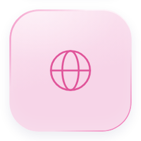 |  |
| `cloud` |  |  | 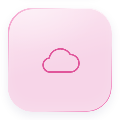 | 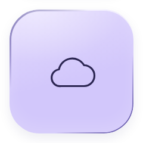 |
| `box` | 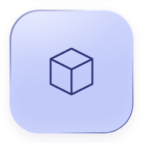 | 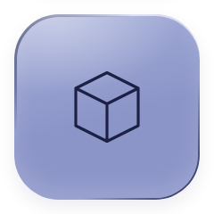 | 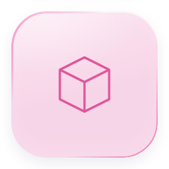 | 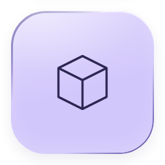 |
| `settings` | 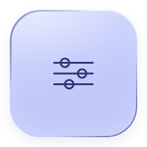 | 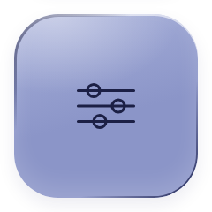 | 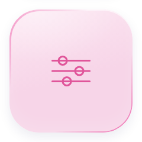 | 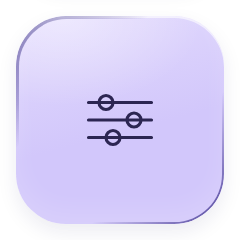 |
| `star` |  |  |  |  |
| `training` |  |  |  |  |
| `chart` |  |  |  |  |
| `bolt` |  |  | 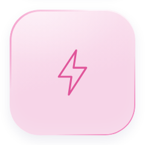 | 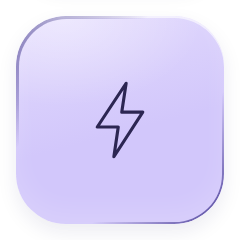 |
